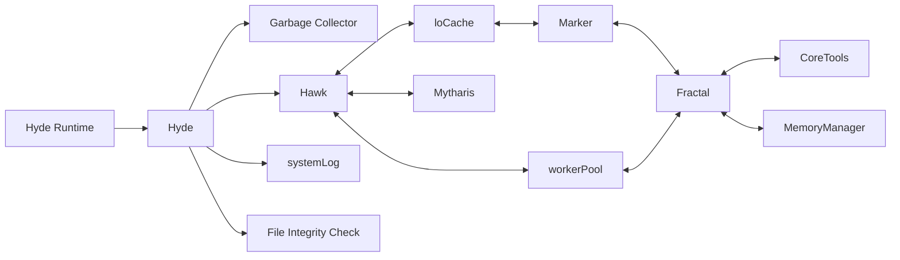

# Hyde

Hyde is a markdown website hosting stack that allows you to turn markdown files into websites

The stack is a monolithic combination of a web server, caching service, markdown to html translator, embedable DSL scripting language and a database

The source is written in pure vanilla JavaScript with a philosophy of writing everything from scratch to avoid heavy libraries

It implements a custom markdown format into which scripts can be embeded together with other custom tags making those markdown files a standalone websites

## Architecture

Bellow is a scheme of how the individual modules are connected to each other inside of the stack



### Explanation

0. Hyde Runtime starts an instance of Hyde

1. Hyde runs Garbage Collector, File Integrity Check and starts systemLog service

2. Hyde settups an instance of Hyde with vairables from the .env file

3. Hawk creates an instance of loCache, Mytharis and workerPool

4. loCache caches files and uses Marker to translate markdown to html

5. Marker translates markdown to html and uses Fractal to compile the embeded Fractal code

6. workerPool uses workers that assemble html responses that contain the result of interpreted Fractal code

7. Fractal both compiles and interprets Fractal code and imports coreTools together with MemoryManager

8. coreTools is first of the core libraries of Fractal that manages IO among other things

9. MemoryManager is the second core library of Fractal that manages virtual memory

## Components

### Hyde Runtime

Run is a custom wrapper script that allows you to run individual parts of the project easily

### Hyde

Hyde starts the individual modules of the stack

It also runs Garbage Collector before execution and start systemLog

### Hawk

Hawk is a custom web server and a core component of the stack

The main loop is single threaded to avoid complex mutex states

However it utilises worker pool to handle assembling html responses

### LoCache

LoCache is a simple caching services that allows Hawk to cache needed files in RAM instead of loading them from drive

It allows defining an initial cache configuration of files that are to be cached on startup of Hyde

It also features file statistics checks which allow the cache to recache updated files

In terms of markdown it allows caching from html and fsc files skiping the compilation process

### Fractal

Fractal is a custom DLS scripting language inspired by Python, JavaScript and NumScript

The code of Fractal is split into code blocks in which each statement is a function

It's source code is compiled into bytecode which is then interpreted inside of a virtual machine

Inside of Hyde it follows a PHP philosophy of scripts running entirely on the server side

### Marker

Marker is a markdown to html translator script

It supports basic GitHub markdown together with custom Marker tags

It also allows defining css, title or icon directly inside of the markdown file

### Mytharis

The future database like persistant storage of the stack that is yet to be implemented

## Support scripts

### Garbage Collector

Tool that deletes left over files after user deletes the original markdown file

## Repository Content

```
━━━━━━━━━━━━━━━━━━━━━━━━━━━━━━━━━━━━━━━━━━━━━━━━━━━━━━━━━━━━━━━━━━━━━━━━━━━━━━━━━
 Language              Files        Lines         Code     Comments       Blanks
━━━━━━━━━━━━━━━━━━━━━━━━━━━━━━━━━━━━━━━━━━━━━━━━━━━━━━━━━━━━━━━━━━━━━━━━━━━━━━━━━
 CSS                       8          368          164          152           52
 JavaScript               63         4833         2109         1542         1182
 Markdown                  3          377            0          245          132
 Shell                     2          335          164           61          110
 Plain Text                2          707            0          576          131
 YAML                      1           37           19           16            2
━━━━━━━━━━━━━━━━━━━━━━━━━━━━━━━━━━━━━━━━━━━━━━━━━━━━━━━━━━━━━━━━━━━━━━━━━━━━━━━━━
 Total                    79         6657         2456         2592         1609
━━━━━━━━━━━━━━━━━━━━━━━━━━━━━━━━━━━━━━━━━━━━━━━━━━━━━━━━━━━━━━━━━━━━━━━━━━━━━━━━━
```

```
.
├── certificates
├── compose.yaml
├── documents
│   └── materials.md
├── hyde.js
├── LICENSE.txt
├── logs
│   ├── fractalCli
│   ├── hyde
│   ├── hydeDocker
│   ├── startupScripts
│   │   └── garbageCollector
│   └── tests
│       ├── fractalTest
│       └── hawkTestPerformance
├── README.md
├── run.sh
├── source
│   ├── constants
│   │   ├── macros.js
│   │   └── paths.js
│   ├── fractal
│   │   ├── constants
│   │   │   ├── functions.js
│   │   │   └── instructionLimit.js
│   │   ├── coreTools
│   │   │   ├── coreTools.js
│   │   │   └── methods
│   │   │       ├── inputOutput
│   │   │       │   ├── clearShell.js
│   │   │       │   ├── codeInput.js
│   │   │       │   └── shellOutput.js
│   │   │       └── math
│   │   │           ├── convertToNumberUsingAscii.js
│   │   │           ├── fractalEval.js
│   │   │           └── isNumber.js
│   │   ├── fractal.js
│   │   ├── memoryManager
│   │   │   ├── memoryManager.js
│   │   │   └── methods
│   │   │       ├── allocateMemorySpace.js
│   │   │       ├── getVariableValue.js
│   │   │       └── setVariableValue.js
│   │   └── methods
│   │       ├── argumentsSupport
│   │       │   ├── checkInputArguments.js
│   │       │   ├── generateOutputArguments.js
│   │       │   └── loadInputArguments.js
│   │       ├── compiler
│   │       │   ├── argumentCounter.js
│   │       │   ├── argumentCountVerifier.js
│   │       │   ├── compile.js
│   │       │   ├── lexer.js
│   │       │   ├── parser.js
│   │       │   └── scanner.js
│   │       └── interpreter
│   │           ├── execute.js
│   │           └── interpreter.js
│   ├── hawk
│   │   ├── hawk.js
│   │   ├── methods
│   │   │   ├── assembleResponse.js
│   │   │   ├── initServer.js
│   │   │   └── runServer.js
│   │   └── workerPool
│   │       ├── methods
│   │       │   ├── addWorker.js
│   │       │   ├── initWorkers.js
│   │       │   ├── processQueue.js
│   │       │   └── runTask.js
│   │       └── workerPool.js
│   ├── loCache
│   │   ├── constants
│   │   │   └── initCacheContent.js
│   │   ├── loCache.js
│   │   └── methods
│   │       ├── cacheFile.js
│   │       ├── getFile.js
│   │       └── initCache.js
│   ├── marker
│   │   ├── marker.js
│   │   └── methods
│   │       ├── convert.js
│   │       ├── generateHtml.js
│   │       ├── inputOutput
│   │       │   ├── loadMarkdown.js
│   │       │   └── saveHtml.js
│   │       ├── reflowMarkdown.js
│   │       └── segmentSpecific
│   │           ├── fractal
│   │           │   ├── compileFractalCode.js
│   │           │   └── extractFractal.js
│   │           ├── processJsonWeb.js
│   │           └── processWrapper.js
│   ├── mytharis
│   │   └── mytharis.js
│   └── startupScripts
│       ├── consoleCleaner.js
│       ├── consoleDebug.js
│       ├── fileIntegrityCheck.js
│       ├── garbageCollector.js
│       └── systemLog.js
├── static
│   ├── icons
│   │   └── favicon.ico
│   ├── images
│   │   └── hyde.png
│   ├── scripts
│   │   ├── example.fsc
│   │   └── index.fsc
│   └── styles
│       ├── core
│       │   ├── dark.css
│       │   ├── hacker.css
│       │   └── light.css
│       ├── template.css
│       └── theAxes
│           ├── azure.css
│           ├── crimson.css
│           ├── gold.css
│           └── seaGreen.css
├── templates
│   ├── html
│   │   ├── example.html
│   │   └── index.html
│   └── markdown
│       ├── example.md
│       └── index.md
├── tests
│   ├── fractalTest
│   │   ├── fractalTest.js
│   │   └── testCases.jsonc
│   └── hawkTestPerformance.sh
└── tools
    └── fractalCli.js
```

## License

This project is licensed under the GNU General Public License v3.0 - see the [LICENSE](LICENSE.txt) file for details

Copyright (c) 2026 Daniel Hora