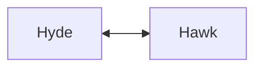

# Hyde

Hyde is a markdown website hosting stack that allows you to turn markdown files into websites

The stack is a monolithic combination of a web server, caching service, markdown to html translator, embedable DSL scripting language and a database

The source is written in pure vanilla JavaScript with a philosophy of writing everything from scratch to avoid heavy libraries

It implements a custom markdown format into which scripts can be embeded together with other custom tags making those markdown files a standalone websites

## Runtime

Bellow is a short explanation of how Hyde processes markdown files

## Architecture

Bello is a scheme of how the individual modules are connected to each other inside of the stack

## Components

### Run

Run is a custom wrapper script that allows you to run individual parts of the project easily

### Hawk

Hawk is a custom web server and a core component of the stack

The main loop is single threaded to avoid complex mutex states

However it utilises worker pool to handle assembling html responses

### LoCache

LoCache is a simple caching services that allows Hawk to cache needed files in RAM instead of loading them from drive

It allows defining an initial cache configuration of files that are to be cached on startup of Hyde

It also features file statistics checks which allow the cache to recache updated files

In terms of markdown it allows caching from html and fsc files skiping the compilation process

### Fractal

Fractal is a custom DLS scripting language inspired by Python, JavaScript and NumScript

The code of Fractal is split into code blocks in which each statement is a function

It's source code is compiled into bytecode which is then interpreted inside of a virtual machine

Inside of Hyde it follows a PHP philosophy of scripts running entirely on the server side

### Marker

Marker is a markdown to html translator script

It supports basic GitHub markdown together with custom Marker tags

It also allows defining css, title or icon directly inside of the markdown file

### Mytharis

The future database like persistant storage of the stack that is yet to be implemented